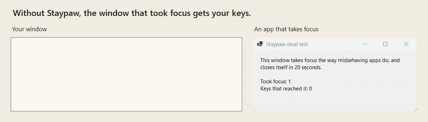
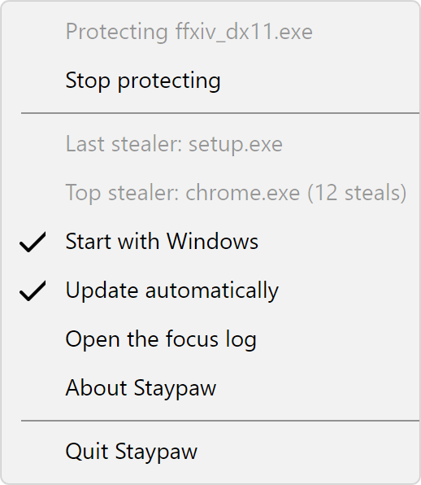

<h1 align="center">
  <picture>
    <source media="(prefers-color-scheme: dark)" srcset="docs/brand/lockup-dark.svg">
    
  </picture>
</h1>

**Nothing takes your keyboard.** While you type or play, Staypaw puts focus back where it belongs.

Windows lets apps pull focus to themselves: a chat popup, an installer, a browser an agent is driving. Your next keypress lands in the wrong window, sometimes on its default button. Space has cancelled a Visual Studio install, and Esc has killed a Bluetooth transfer. [PowerToys #65](https://github.com/microsoft/PowerToys/issues/65) has asked for a fix since 2019.

## Install

Download `staypaw-setup-win-x64.exe` from the [latest release](https://github.com/hazeliscoding/staypaw/releases/latest) and run it. It installs for you alone, without admin rights, and starts Staypaw in your tray, then again each time you sign in.

SmartScreen may call it an unrecognized app until enough people have run it. Under **More info**, it names Hazel Granados as the publisher: that's the signature on every release.

- **Updates:** an installed copy updates itself from GitHub Releases. It restarts into a new version once your protected app isn't in front, and the tray menu turns this off.
- **No installer:** unzip `staypaw-portable-win-x64.zip` anywhere and run `Staypaw.exe`. It never updates itself. It starts at sign-in from that folder, so turn off Start with Windows in its tray menu before you move or delete it.
- **Checksums:** each release's `SHA256SUMS` lists both files.
- **Uninstall:** from Settings › Apps › Installed apps.

 

## Before and after

| You're… | Something takes focus | Without Staypaw | With Staypaw |
|---|---|---|---|
| typing in your editor | a chat popup | your next words go into the chat | focus comes straight back, and the keys you typed land in your editor |
| typing a password | a background app's window | your password goes into that window, and you have to change it | focus comes straight back, and your password lands where you were typing |
| coding while an agent tests in a browser | the browser opens a page, every few seconds | the browser keeps jumping in front, and your keys go into it | focus comes back while you type, or every time if your editor is protected |
| crafting in a game, hands off the keyboard | an agent's browser opens a page | the game loses focus | the game keeps focus, because you protected it |
| playing a match | a work chat message | the game loses focus mid-match | focus goes back to the game, and keys pressed meanwhile are dropped, never replayed into it |
| pressing Space | an installer with a Cancel button | the install is cancelled | the key never reaches the installer |

From reports in [PowerToys #65](https://github.com/microsoft/PowerToys/issues/65), [Playwright #41306](https://github.com/microsoft/playwright/issues/41306) and [chrome-devtools-mcp #2856](https://github.com/ChromeDevTools/chrome-devtools-mcp/issues/2856).

## What it does

- **Protects an app you pick.** Nothing takes focus from it unless you click or Alt+Tab away, even while you're idle.
- **Keeps focus where you're typing.**
- **Holds stray keys.** A key you press during a steal never reaches the app that stole focus. It goes to your window once focus is back, or is dropped if that window is a game.
- **Tells you which app did it,** in a log you can open.
- **Installs signed,** for you alone, without admin rights.

 

## Using it

<picture>
  <source media="(prefers-color-scheme: dark)" srcset="docs/screenshots/tray-dark.png">
  
</picture>

Right-click the paw in your tray. From there you can:

- protect the app you were just in;
- see which app took focus last, and which takes it most;
- turn Start with Windows and automatic updates off or on;
- open the focus log, which lists every focus change and what Staypaw did about it.

 

## The trust contract

Staypaw watches your keyboard, so it has to be easy to trust.

- **Nothing injected.** Staypaw never loads code into another app, and never touches a game's process. Its keyboard hook is the low-level kind, which runs inside Staypaw itself.
- **No telemetry.** The only network call is the update check, which asks GitHub Releases for a newer version and sends nothing else. The tray menu turns it off. The code that sees your keys can't reach the network: a test fails if it references the updater or any networking code.
- **No keys stored.** It keeps the time of each keypress, never the key. Keys held during a steal stay in memory for a moment, then go to your window or are dropped. They never go to a game. Nothing about them is written to disk.
- **Open source,** so you can check all of this instead of trusting it.

## Alternatives

Checked against each project's own docs on 2026-10-21.

| | Staypaw 1.0 | [NoFocusSteal](https://github.com/BoazCohenJ/NoFocusSteal) 1.3.2 | [Windhawk mod](https://windhawk.net/mods/prevent-focus-stealing) 1.0.2 | [FocusLogger](https://github.com/JocysCom/FocusLogger) 1.3.12 |
|---|---|---|---|---|
| Stops steals | after they happen, then puts focus back | after they happen, then puts focus back | before they happen, for the apps you list | no, it logs them |
| Injects into other apps | no | no | yes, into every process by default | no |
| Protects one app while you're idle | yes | Strict mode, for every app at once | you list the stealers instead | no |
| A key typed during a steal | held, never reaches the stealer | can land in the stealer (up to 1 in 185 keys in its own test) | none land | n/a |
| Signed, on winget | signed, not on winget yet | not signed, not on winget | not checked | signed |

**Pick NoFocusSteal** if you want every app protected at once: its Strict mode does that. **Pick the Windhawk mod** if you know which apps steal focus and don't mind injection: it stops a steal before any key lands, which a tool that reacts afterwards can't promise. **Pick FocusLogger** if you only want to know which app it is.

## Contributing

Issues are welcome. Open work is on the [Staypaw board](https://github.com/users/hazeliscoding/projects/12), and decisions are in [ROADMAP.md](ROADMAP.md).

## License

[Apache-2.0](LICENSE). Calla, the cat-eared homebody in this README, was drawn with an AI image model and is Apache-2.0 like the code. Hand-drawn art of her by [@wrenishacking](https://github.com/wrenishacking) is on the way.
