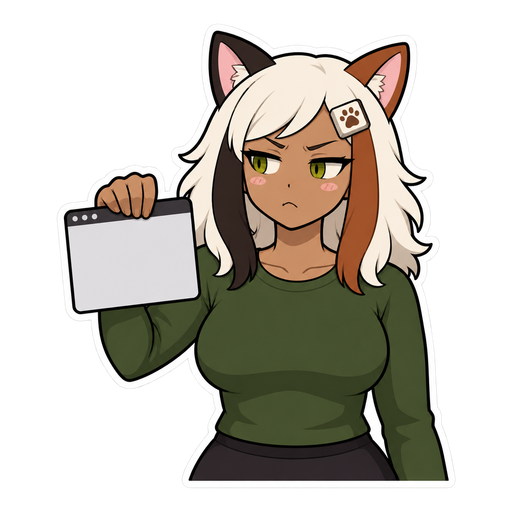

<h1 align="center">
  <picture>
    <source media="(prefers-color-scheme: dark)" srcset="docs/brand/lockup-dark.svg">
    
  </picture>
</h1>

**Nothing takes your keyboard.** While you type or play, Staypaw puts focus back where it belongs.

Windows lets apps pull focus to themselves: a chat popup, an installer, a browser an agent is driving. Your next keypress lands in the wrong window, sometimes on its default button. Space has cancelled a Visual Studio install, and Esc has killed a Bluetooth transfer. [PowerToys #65](https://github.com/microsoft/PowerToys/issues/65) has asked for a fix since 2019.

> **Status:** in development. Staypaw already logs every steal, protects the app you pick and holds stray keys, but there's no release to install yet. See [ROADMAP.md](ROADMAP.md). Until Staypaw ships, use one of the tools under [Alternatives](#alternatives).

 

## Before and after

| You're… | Something takes focus | Without Staypaw | With Staypaw |
|---|---|---|---|
| typing in your editor | a chat popup | your next words go into the chat | focus comes straight back, and the keys you typed land in your editor |
| crafting in a game, hands off the keyboard | an agent's browser opens a page | the game loses focus | the game keeps focus, because you protected it |
| pressing Space | an installer with a Cancel button | the install is cancelled | the key never reaches the installer |

## What it does

Planned for 1.0:

- **Protects an app you pick.** Nothing takes focus from it unless you click or Alt+Tab away, even while you're idle.
- **Keeps focus where you're typing.**
- **Holds stray keys.** A key you press during a steal never reaches the app that stole focus. It goes to your window once focus is back, or is dropped if that window is a game.
- **Tells you which app did it,** in a log you can open.
- **Installs signed,** through winget.

## The trust contract

Staypaw watches your keyboard, so it has to be easy to trust.

- **Nothing injected.** Staypaw never loads code into another app, and never touches a game's process. Its keyboard hook is the low-level kind, which runs inside Staypaw itself.
- **No network.** There is no networking code, no updater and no telemetry.
- **No keys stored.** It keeps the time of each keypress, never the key. Keys held during a steal stay in memory for a moment, then go to your window or are dropped. They never go to a game. Nothing about them is written to disk.
- **Open source,** so you can check all of this instead of trusting it.

## Alternatives

Checked against each project's own docs on 2026-10-21.

| | Staypaw (planned) | [NoFocusSteal](https://github.com/BoazCohenJ/NoFocusSteal) 1.3.2 | [Windhawk mod](https://windhawk.net/mods/prevent-focus-stealing) 1.0.2 | [FocusLogger](https://github.com/JocysCom/FocusLogger) 1.3.12 |
|---|---|---|---|---|
| Stops steals | after they happen, then puts focus back | after they happen, then puts focus back | before they happen, for the apps you list | no, it logs them |
| Injects into other apps | no | no | yes, into every process by default | no |
| Protects one app while you're idle | yes | Strict mode, for every app at once | you list the stealers instead | no |
| A key typed during a steal | held, never reaches the stealer | can land in the stealer (up to 1 in 185 keys in its own test) | none land | n/a |
| Signed, on winget | planned | not signed, not on winget | not checked | signed |

**Pick NoFocusSteal today:** it works, and Staypaw has no release yet. **Pick the Windhawk mod** if you know which apps steal focus and don't mind injection: it stops a steal before any key lands, which a tool that reacts afterwards can't promise. **Pick FocusLogger** if you only want to know which app it is.

## Contributing

Issues are welcome. Planning lives in [ROADMAP.md](ROADMAP.md).

## License

[Apache-2.0](LICENSE). Calla, the cat-eared homebody in this README, was drawn with an AI image model and is Apache-2.0 like the code. Hand-drawn art of her by [@wrenishacking](https://github.com/wrenishacking) is on the way.
