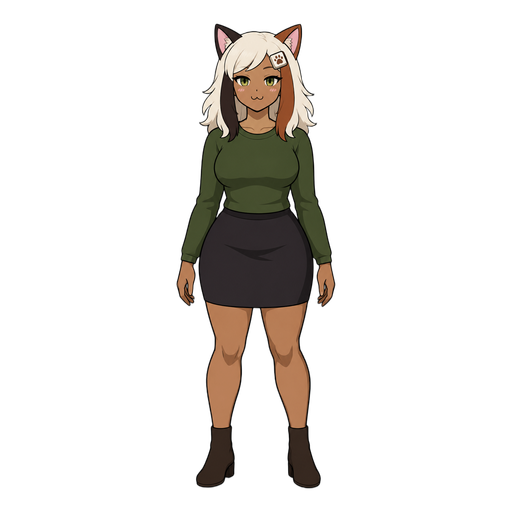

# Staypaw brand

The logo is a paw holding a window down.

- `mark.svg` / `mark-dark.svg`: the paw mark, for light and dark backgrounds.
- `lockup.svg` / `lockup-dark.svg`: the mark plus the "staypaw" wordmark, as in the README's title.
- The wordmark is Fredoka SemiBold (SIL Open Font License), lowercase, with -0.01em letter spacing, converted to paths because GitHub can't load web fonts inside SVGs. Use the SVGs; don't re-typeset it. `scripts/make_lockup.py` rebuilds both lockups from the font and the mark, and its header says how. Rerun it whenever the mark changes.
- `app-icon.svg` is the mark on a paper tile, the source of `staypaw.ico` and `app-icon-256.png`. `scripts/make-icons.cs` renders them.

Logo colours: ink `#1d1a16` and rust `#b5601f` on light backgrounds, paper `#f2ede2` and rust `#e8954f` on dark ones.

## Calla

Calla Keyes is a calm, quietly stubborn homebody who sits down beside your work like a cat on a warm keyboard, and won't move unless you pick her up yourself, as Staypaw counts a switch only if you made it. She settles beside your work and never inside it, as Staypaw never injects code. Her head carries the brand: warm white hair like the paper, a rust ear and lock like the paw, a dark chocolate ear and lock like the ink, and a keycap clip with a rust paw print. She is the face of the README, launch posts and the app's welcome window; the paw mark stays the logo and the app icon.

| File | Sticker | Means |
|---|---|---|
| `calla/base.png` | Full body | Her reference |
| `calla/stay-put.png` | Something tugs her sleeve, and she doesn't budge | A steal is undone, and focus stays put |
| `calla/that-one.png` | Holding a pop-up out by the scruff | The log names the stealer, as the tray's last and top stealer lines do |
| `calla/slow-blink.png` | A slow blink, arms folded | All quiet. A cat's slow blink means "I trust you". The welcome and About window shows `slow-blink-256.png`. |

- The PNGs are 512 px square with transparent backgrounds, and the stickers have a white die-cut border. `slow-blink-256.png` is the 256 px export, built into the app.
- `stay-put.png` has two see-through gaps between her arms and her waist, which show as dark slivers on dark backgrounds. Keep it off dark surfaces, GitHub's dark mode included, until they're filled.
- Her colours, sampled from `calla/base.png`: hair `#F0E5D5`, rust `#954E29`, chocolate `#332521`, olive `#464E2F`, skirt `#30292C` and skin `#B87D56`. None of them is a text colour.
- Her art is AI-generated with OpenAI's gpt-image-2.5-flare, from a written character spec, and like the code it is Apache-2.0. Don't edit or redraw her here; new stickers come from the same spec, so the set stays consistent.

 
